# 第5章 まとめ（要点＋計算問題）

みんなで決めるということ ― 民主主義と社会的意思決定（教科書 p.107〜133）

## ① 覚える用語

| 用語 | 意味 |
|---|---|
| 政府の失敗 | 政治過程に原因があって、社会的余剰を最大にする政策が選ばれないこと |
| 政治経済学 | 経済学による政治過程の研究。広義の公共経済学に含まれるが、1つの学術分野として発展している |
| 公共選択論 | 政治学者と連携し、実際の政治制度のもとで人々がどう振る舞い、どんな結果になっているかを観察する分野 |
| 社会選択論 | 数理モデルを使い、考えうるあらゆる政治制度の中からもっとも望ましいものを見つけ出そうとする分野 |
| 選好 | さまざまな選択肢に対する好み |
| 社会的選択ルール | 有権者たちの選好に応じて、社会としてどの選択肢に何番目の優先順位を与えるかを決めるルール（選好の集計） |
| 選挙 | 政治家として権力を振るう者たちを選ぶための手続きの1つ |
| 民主制 | みんなで政治を行う仕組み |
| 間接民主制 | 有権者たちに選ばれた政治家たちが政治を行う仕組み |
| 権力 | 他人に何かを強いる力（例：納税） |
| 正当性 | 「権力を持つことは理に適っている」と納得するための根拠 |
| 投票率 | 有権者のうち投票に行った人の割合 |
| 貯蓄可能投票（storable votes） | 各委員に複数の票を渡しておき、複数の投票のうちどこで何票使うかを自由に選んでよいとするルール |
| 票の売買 | 票をお金で売り買いすること（Column④）。便益の和を大きくする手段になりうるが、正当性や選挙後の政策の点で問題がある |
| 投票の費用 | 投票に行くための時間や労力に加えて、行かなければできた仕事や趣味ができなくなること（機会費用） |
| コンドルセ勝者 | 他のどの選択肢と比べても、過半数の人たちから好まれる選択肢 |
| コンドルセ敗者 | 他のどの選択肢と比べても、過半数の人たちから嫌われる選択肢 |
| コンドルセ法 | 2つの選択肢を比べて過半数から好まれるほうを勝ち残りとし、勝ち残りと新しい選択肢を比べることを繰り返すプロセス |
| 推移性 | 「XよりYが好きで、YよりZが好きなら、XよりZが好き」という性質 |
| コンドルセのパラドックス | 各有権者の選好は推移性を満たすのに、投票の結果（社会全体）は推移性を満たさないこと |
| 絶対多数決 | 過半数から好まれる選択肢が選ばれる。過半数に達する選択肢がなければ何も選ばれない |
| 相対多数決 | いちばん多くの有権者から（1番目に）好まれる選択肢が選ばれる。過半数かどうかは問わない |
| ボルダ方式 | 3つの選択肢なら、1番目に2点、2番目に1点、3番目に0点を与え、合計点がいちばん大きい選択肢を選ぶ |
| （アローの）不可能性定理 | 選択肢が3つ以上のとき、推移性を満たす社会的選択ルールの中に、選好の非限定性・パレート性・独立性・非独裁性の4つを同時に満たすものはない |
| 選好の非限定性 | 有権者たちがどんな選好を持っていても機能すること |
| パレート性 | すべての有権者がAよりBを好むなら、社会としてもAよりBに高い順位を与えること |
| 独立性 | 2つの選択肢の社会的な順位は、その2つに対する有権者たちの選好だけで決まり、他の選択肢に影響されないこと |
| 非独裁性 | 他の人の選好に関係なく、ある1人の選好と同じ順位が常に社会の順位になる「独裁者」がいないこと |
| 一次元の政策空間 | 政策（選択肢）の対立軸が1つで、すべての選択肢を数直線上に並べられること（例：消防予算を0円〜全額のどれにするか） |
| 至福点 | 各有権者が1番目に好む選択肢（いちばん大きな便益が得られる金額）。理想点・飽和点とも呼ばれる |
| 単峰性 | 至福点から離れれば離れるほど便益が低下すること。グラフで上にとがっている個所（峰）が1つ。右下がり・右上がりの直線でもよい |
| 中位投票者 | 至福点が有権者全体のちょうど真ん中（中位）に位置する有権者 |
| 中位投票者定理 | すべての有権者の選好が単峰性を満たすとき、中位投票者の至福点がコンドルセ勝者になる |
| 熟議民主主義（討議民主主義） | 市民の中からランダムに選ばれた人たちが集まって政策を議論し、意見をまとめてもらう試み（Column⑤）。議論を通じて選好が変化することが期待される |
| 交渉 | 選好が変わらないまま、交渉力や取引によって話が決着すること |
| 誠実投票 | 自分が1番目に好む選択肢に常に投票すること |
| 死票 | 結果に何も影響を与えられずに終わる票 |
| 戦略的投票 | 自分の1票が結果にどう影響するかを考えて投票すること |
| ギバード・サタースウェイトの定理 | 選択肢が3つ以上のとき、選好の非限定性・選択肢の非限定性・戦略的操作不可能性・非独裁性の4つを同時に満たす（1つの選択肢を選ぶ）社会的選択ルールは存在しない |
| 選択肢の非限定性 | 有権者たちがどう報告しても決して選ばれない選択肢が存在しないこと |
| 戦略的操作不可能性 | 嘘の報告をして自分の便益を高められる（戦略的に操作できる）有権者が誰もいないこと。このとき全員にとって正直に報告するのがいちばん得 |
| 非独裁性（ギバード・サタースウェイト） | ある特定の有権者が1番目に好む選択肢が常に選ばれる、という独裁者がいないこと |
| デュヴェルジェの法則 | 1つの選択肢が選ばれる相対多数決では、2つの選択肢に票が集まる傾向があること |
| 小選挙区制 | 当選者数1の選挙区を議員定数と同じ数だけ作り、選挙区ごとに最多得票の候補者が当選する制度（1つの選挙区では相対多数決と同じ） |
| 二大政党制 | 2つの大きな政党が主となって政治を営む体制 |
| 決選投票 | はじめに絶対多数決を行い、過半数の候補者がいなければ上位2人でもう一度多数決を行うルール（フランスの大統領選挙）（章末問題5-2） |

## ② 重要ポイント

1. **政府も社会的余剰の最大化を目指す1つの主体とは限らない。** 政治家は選挙区の有権者や支持企業の期待に応え、自分の利害や出世の野心も持つ。過半数を確保するために法案を修正することもある。こうして社会的余剰を最大にする政策が選ばれないことを**政府の失敗**という。
2. **政治学は「正当性」、経済学は「社会的余剰」に着目して選挙を見る。** 国民が納得する選挙の条件として、①多くの有権者に支持された候補者が当選すること、②不正がないこと、③投票率が低くないこと、が挙げられる。
3. **多数の支持 ≠ 便益の和の最大（表5-1）。** 有権者1・2が候補者Aから1ずつ、有権者3が候補者Bから3の便益を得るとき、多数決ではA（便益の和2）が当選するが、便益の和はB（3）のほうが大きい。**1人1票では「どちらを好むか」は反映されるが、「どの程度好むか」は反映されない。**
4. **貯蓄可能投票なら、好む程度を票に反映できる。** 便益があまり変わらない投票では票を貯め、便益が大きく異なる投票で一挙に投じる。表5-1なら有権者3が貯めた票を使ってBを当選させ、便益の和が最大になる。ただし、①複数の選挙にまたがって複雑（他人が何票残すかにも影響される）、②無関心で貯まった票が一挙に投じられると正当性が問われる、ので実際の選挙への応用は難しい。
5. **票の売買（Column④）。** 表5-1で、有権者3は3までなら払ってでもBを当選させたく、有権者1・2は1もらえれば譲ってよいので、**1以上3以下の価格**で票が売買され、Bが当選する。モデルの中では便益の和を最大にする手段になるが、実際には、①お金を配った候補者が当選して正当性に問題がある、②お金は移転するだけで社会的余剰は増えず、政策が評価されていないので選挙後に有権者が不利益をこうむる、という問題がある。
6. **不正は社会的余剰を小さくする。** 不正に使うお金・時間・労力は資源の浪費（費用↑）で、支持されない候補者が当選しやすくなる（便益↓）。ただし、悪い政治家だけが不正を働くなら、不正の発覚が悪い政治家を見つける情報になる。「現在の費用増・便益減」を「将来の費用減・便益増」が上回るなら、ある程度の不正は望ましいことになる（なかなか上回りそうにない）。
7. **投票率が高いことの便益は3つ。** ①少数にしか支持されない候補者の当選を阻止し、多くの情報を集めて望ましい候補者を当選させる、②「政治に参加できた」などの心理的な便益、③間接民主制の維持に貢献する（外部経済）。一方で**投票の費用**（機会費用）があり、それが便益を上回るなら投票率は低いほうが社会的余剰が大きくなる。
8. **「良い側面もある」という指摘にとどめる。** 実際の提言としては「不正や低投票率を避ける対策を打つべき」となることがほとんど。社会的余剰の観点から見ると、気づかなかった一側面に気づけることが重要。
9. **コンドルセ勝者を望ましさの基準にする。** 社会的余剰最大化より満たされやすい基準として、他のどの選択肢と比べても過半数から好まれる選択肢（コンドルセ勝者）が選ばれることを考える。**選択肢が2つなら、コンドルセ法でも多数決でもコンドルセ勝者が選ばれる。**
10. **選択肢が3つ以上だとコンドルセのパラドックスが起こりうる（表5-2）。** AはBに勝ち、CはAに勝ち、BはCに勝つ、という循環が生じ、コンドルセ法ではどの選択肢も選べずに終わる。
11. **絶対多数決は「過半数」を強く重んじ、相対多数決は必ず何かを選ぶ。** 表5-2では、絶対多数決は何も選ばず、相対多数決は3つが1位に並んでランダム（確率1/3ずつ）に選ぶ。
12. **相対多数決ではコンドルセ勝者が選ばれず、コンドルセ敗者が選ばれることもある（表5-3）。** 1番目に好む人数（A3人・B2人・C2人）ではAだが、コンドルセ勝者はB。しかもAは有権者の過半数にとって最下位のコンドルセ敗者。**相対多数決は1番目の情報しか使わない**のが問題。
13. **ボルダ方式は2番目・3番目の情報も使う。** 表5-3ではA6点・B9点・C6点でBが選ばれ、コンドルセ敗者の当選を防げる。スロベニアの国民議会の少数民族代表枠や、メジャーリーグの最優秀選手（1番目14点、2番目9点、以下1点ずつ減る）で使われている。
14. **ボルダ方式でもコンドルセ勝者が選ばれないことがある（表5-4）。** 3人から1番目に好まれるBがコンドルセ勝者だが、ボルダ方式ではA7点・B6点・C2点でAが選ばれる。Bは2人から最下位で0点、Aは残り3人から2番目で1点ずつもらえるため。**ボルダ方式では、1番目でなくてもそれなりに好んでもらうことが重要。**
15. **不可能性定理：4つの自然な性質を同時に満たすルールはない。** 推移性を満たす社会的選択ルールで、選好の非限定性・パレート性・独立性・非独裁性をすべて満たすものは見つけられない（選択肢3つ以上。同順位は許される）。
16. **ボルダ方式は独立性を満たさない（表5-4→表5-5）。** 有権者3・4・5の選好でCをAより上に移しても、どの有権者でもAとBの上下関係は変わらない。それなのに、AとBの点数はA7・B6からA4・B6に変わり、社会としての順位が逆転する。
17. **コンドルセのパラドックスは「選好の非限定性」と「推移性」が両立しない例。** 2つずつ多数決で比べるルールは、パレート性・独立性・非独裁性を満たすが、表5-2のような選好があると社会の順位が推移性を満たさない。
18. **4つのうち1つをあきらめれば、他の3つを満たすルールは見つかる。** いちばん多く許容されるのは、**選好の非限定性**をあきらめること（選好を限定して議論する）。もっとも広く使われるのは、**一次元の政策空間で単峰性を満たす選好**。
19. **単峰性：至福点から離れるほど便益が下がる（表5-6・図5-1）。** 有権者1（右下がり）や有権者5（右上がり）の直線も、上にとがっている個所が1つなので単峰性を満たす。
20. **中位投票者定理：単峰性のもとでは、中位投票者の至福点がコンドルセ勝者。** 表5-6では有権者3の至福点2000万円。それより左の選択肢と比べると有権者3と右側の全員（3・4・5）が、右の選択肢と比べると有権者3と左側の全員（1・2・3）が2000万円を好む。有権者数が奇数なら左右に同じ数の有権者がいるので、必ず過半数になる。
21. **中位投票者の至福点は「平均」ではなく「真ん中」。** 端の有権者の至福点がどれだけ動いても、真ん中の有権者が変わらなければ結果は変わらない。
22. **民主的に選ばれた政策は、必ずしも社会的余剰を最大にしない。** 表5-6の便益の和は5000万円で最大（28）だが、選ばれるのは2000万円（25）。有権者4・5は至福点から1000万円離れるごとに2ずつ、有権者1・2・3は1ずつ便益が下がり、4・5のほうが離れることを強く嫌がっている。しかし1人1票ではその強さは反映されない（表5-1と同じ理由）。
23. **単峰性のチェックは、選択肢の並べ方をすべて試す（図5-2）。** A・B・Cは名前にすぎず、横軸に左からA・B・Cと並べる必要はない。並べ方の問題は「真ん中にどれを置くか」に置き換えられ、**真ん中の選択肢がもっとも嫌いな有権者がいたら、その人の選好は単峰性を満たさない**（真ん中がくぼんで峰が2つ）。
24. **どの選択肢も少なくとも1人からもっとも嫌われているなら、どう並べても単峰性を満たさない人がいる。** 表5-2がそれにあたり、中位投票者定理が使えず、実際にコンドルセのパラドックスが生じた。
25. **熟議には投票の弱点を補う役割がある（Column⑤）。** 経済学は選好を変わらないものとして扱うが、熟議民主主義は議論による選好の変化を念頭に置く。表5-3で有権者3がAを3番目と思うようになれば（表5-7）、相対多数決でもコンドルセ勝者Bが選ばれる。
26. **有権者は必ずしも誠実投票をしない。** 1番目に好む選択肢が票を集められそうにないなら、死票を避けるため、票を集められそうな選択肢の中でいちばん選ばれてほしいものに投票する（戦略的投票）。
27. **ギバード・サタースウェイトの定理：正直に報告させるルールには独裁者がいる。** 社会として1番目の選択肢だけ決める（アローより決めることが少ない）のに、選好と選択肢の非限定性を満たし、誰も戦略的に操作できないルールは独裁制しかない。独裁者は嘘をつく必要がなく、他の人は嘘をついても結果を変えられない。
28. **相対多数決は戦略的に操作できる（表5-3）。** 有権者6（C＞B＞A）が「Bが1番目」と報告すると、A・Bが3票ずつで1/2ずつ選ばれ、Aが確率1で選ばれるより得。有権者5が「Cが1番目」と報告してA・Cを3票ずつにする操作もある。
29. **デュヴェルジェの法則。** 2番目に好む選択肢に票を移す戦略的投票が起きるため、相対多数決では2つの選択肢に票が集まりやすい。小選挙区では2人の候補者に票が集まり、国全体として二大政党制になりやすい。どの選挙制度を採用するかが政党政治のあり方に影響する。

## ③ 投票ルールごとの勝者の求め方

選好の順位表（表5-2〜表5-5の形）が与えられたら、次の順に計算する。

| ルール | 求め方 |
|---|---|
| **相対多数決** | 1番目に好む人数を数え、いちばん多い選択肢 |
| **絶対多数決** | 1番目に好む人数が**過半数**の選択肢。なければ「何も選ばれない」 |
| **コンドルセ法（総当たり）** | すべての2つの組（A–B、B–C、A–C）について、どちらを上位に置く人が多いかを数える。全部に勝つのがコンドルセ勝者、全部に負けるのがコンドルセ敗者。循環すればコンドルセのパラドックス |
| **ボルダ方式** | 各有権者が1番目2点・2番目1点・3番目0点を与え、合計がいちばん大きい選択肢 |
| **決選投票** | 1回目は絶対多数決。過半数がいなければ、1番目に好む人数の上位2つで多数決（章末問題5-2） |

**コツ**
- 2つの組の比較では、**3番目の選択肢の位置は無視**して、その2つのどちらが上にあるかだけを見る。
- 選択肢が3つのとき、ボルダ方式の点数の合計は **3点 × 有権者数** になる（検算に使える）。
- 同じ選好の有権者はまとめて「○人」と数えると速い。

## ④ 独立性・パレート性のチェックの仕方

1. **独立性**：2つの選択肢（例：AとB）について、**どの有権者でもAとBの上下が変わらない**ように、他の選択肢（C）の位置だけを動かす。それで社会としてのAとBの順位が変わったら、独立性を満たさない。
2. **パレート性**：全員がAよりBを好むのに、社会としてAをBより上にすることがあれば、パレート性を満たさない。
3. **非独裁性**：ある1人の順位がいつもそのまま社会の順位になるなら、非独裁性を満たさない。
4. **選好の非限定性**：特定の選好の組み合わせのときに順位がつけられない（循環する・決まらない）、または一部の人の選好しか考えないなら、満たさない。

## ⑤ 中位投票者と単峰性の求め方

**中位投票者の求め方**
1. 各有権者の至福点（便益が最大の選択肢）を求める。
2. 至福点を小さい順（数直線の左から順）に並べる。
3. 有権者が n 人（奇数）なら、**(n＋1)/2 番目**の有権者が中位投票者。その至福点がコンドルセ勝者。

**単峰性のチェック（選択肢に大小関係がないとき）**
1. 各有権者が**もっとも嫌いな選択肢（3番目）**を書き出す。
2. **誰からももっとも嫌われていない選択肢**があれば、それを真ん中に置くと全員が単峰性を満たす。
3. どの選択肢も誰かからもっとも嫌われていれば、どう並べても単峰性を満たさない人がいる。

## ⑥ 戦略的操作の探し方（相対多数決）

1. 誠実投票の結果（選ばれる選択肢）を求める。
2. 1番目に好む選択肢が選ばれない有権者について、**2番目に好む選択肢に投票先を変える**と結果がどう変わるかを調べる。
3. 結果が自分にとって良くなれば（例：嫌いなAが確率1 → 2番目のBと1/2ずつ）、その有権者は戦略的に操作できる。
4. すでに1番目の選択肢が選ばれている有権者には、操作するインセンティブがない。

---

# 計算練習問題

★がついている問題は、教科書の本文・図表にある数値や例をそのまま使った重要問題です。無印は、教科書の数値を変えた応用問題です。

---

## 経済学で選挙を見る

### ★問1（表5-1）

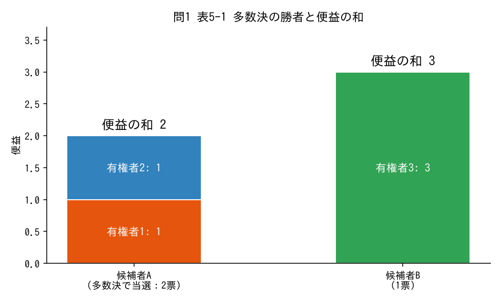

候補者が2人、有権者が3人いる。候補者Aが当選すると有権者1と有権者2は便益1、有権者3は便益0を得る。候補者Bが当選すると有権者1と有権者2は便益0、有権者3は便益3を得る。
(1) 1人1票の多数決では、どちらの候補者が当選するか。
(2) 候補者A、候補者Bが当選したときの便益の和をそれぞれ求めよ。
(3) 多数決の結果は便益の和を最大にしているか。理由も答えよ。

**解答・解説**

(1) **候補者A**
有権者1と有権者2がAを好むので、2票対1票でAが当選する。

(2) **Aの場合2、Bの場合3**
- A：1 ＋ 1 ＋ 0 ＝ 2
- B：0 ＋ 0 ＋ 3 ＝ 3

(3) **最大にしていない（便益の和は1小さい）**
1人1票の投票では、各有権者が「どちらを好むか」は反映されるが、「どの程度好むか」は反映されない。有権者3がBに投票したことからは、BをAより好むことはわかるが、Bの当選から3という大きな便益を得ることはわからない。

### 問2
候補者が2人、有権者が5人いる。各有権者の便益は次のとおりである。

| | 有権者1 | 有権者2 | 有権者3 | 有権者4 | 有権者5 |
|---|---|---|---|---|---|
| 候補者A | 2 | 2 | 2 | 0 | 0 |
| 候補者B | 0 | 0 | 0 | 4 | 5 |

(1) 多数決で当選する候補者と、そのときの便益の和を求めよ。
(2) 便益の和が最大になる候補者と、多数決による損失を求めよ。
(3) 有権者5の便益が5ではなく1だったとすると、(2)の答えはどう変わるか。

**解答・解説**
(1) **候補者A、便益の和6**
3票対2票でAが当選する。2 ＋ 2 ＋ 2 ＝ 6。

(2) **候補者B、損失3**
Bの便益の和は 4 ＋ 5 ＝ 9。9 − 6 ＝ 3 の損失。

(3) **便益の和はAが6、Bが5になり、多数決の結果（A）が便益の和も最大にする**
多数決が便益の和を最大にするかどうかは、少数派の便益がどれだけ大きいかによる。

### ★問3（Column④ 票の売買）

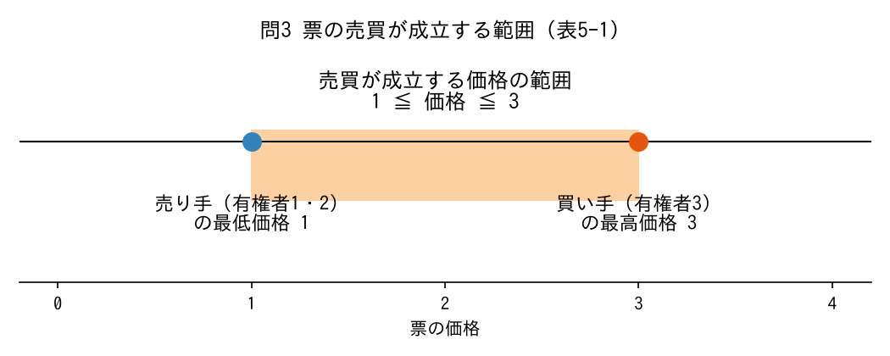

表5-1の例で、票の売買が認められるとする。
(1) 有権者3が票を買うために払ってもよい最大の価格を求めよ。
(2) 有権者1（または有権者2）が票を売ってもよい最低の価格を求めよ。
(3) 票の売買が成立する価格の範囲と、そのときの当選者を答えよ。
(4) 価格2で売買が成立したとき、有権者1・有権者2・有権者3の最終的な利得（便益＋受け取ったお金−払ったお金）と、その合計を求めよ。

**解答・解説**

(1) **3**
Bが当選すれば3の便益を得られるので、3までなら払ってもよい。

(2) **1**
Aをあきらめると便益1を失うので、1以上もらえれば売ってよい。

(3) **1以上3以下。候補者Bが当選する**
有権者3は有権者1か2のどちらか一方から票を買い、自分の票と合わせた2票でBを当選させる。

(4) **有権者1が2、有権者2が0、有権者3が1。合計3**
- 有権者1（売った人）：便益0 ＋ 受け取り2 ＝ 2
- 有権者2：便益0
- 有権者3：便益3 − 支払い2 ＝ 1

合計 2 ＋ 0 ＋ 1 ＝ 3 で、Bの便益の和と同じ。お金は有権者の間を移動しただけなので、社会的余剰の大きさには影響しない。売買の価格は、誰がどれだけ得をするかを変えるだけ。

### ★問4（貯蓄可能投票）
表5-1の候補者AとBの選挙が、定期的に開かれる委員会での投票の1つだとする。委員会では貯蓄可能投票が採用されていて、有権者1と有権者2はこの投票でそれぞれ1票ずつAに投じる。
(1) 有権者3がBを当選させるには、この投票で最低何票投じる必要があるか。
(2) (1)のとき、便益の和はいくつになるか。
(3) 貯蓄可能投票を実際の選挙に応用するのが難しい理由を2つ答えよ。

**解答・解説**
(1) **3票**
Aは2票なので、Bが上回るには3票必要。それまでの投票で票を使わずに貯めておけばよい。

(2) **3**
Bが当選するので 0 ＋ 0 ＋ 3 ＝ 3 で、便益の和が最大になる。可否で便益があまり変わらない投票では票を貯め、大きく変わる投票で一挙に使うことで、好む程度を票に反映できる。

(3)
- **意思決定や票の管理が複数の選挙にまたがって複雑。** 将来どんな選挙があるか予測できないと、貯めるべきか使うべきか判断できない。他の有権者が何票残しそうかにも影響される。
- **無関心で使わなかった票が一挙に投じられることがある。** その選挙結果の正当性が問われ、社会的余剰を最大にする結果になるかも不安視される。

### 問5（不正と投票率）
(1) 不正によって現在の費用が10増えるが、その不正が発覚して悪い政治家が落選し、将来の便益が15増えるとする。社会的余剰最大化の観点から、この不正はどう評価されるか。
(2) ある選挙で、有権者が投票に行くことの便益（情報が集まる効果・心理的な便益・間接民主制の維持への貢献）の合計が1人あたり800円、投票の費用（機会費用を含む）が1人あたり1000円だとする。社会的余剰最大化の観点からは、投票率は高いほうがよいか低いほうがよいか。
(3) (1)(2)の結論から、「不正は認めるべき」「投票率は低くてよい」と提言してよいか。

**解答・解説**
(1) **望ましいと評価される（差し引き＋5）**
将来の便益増15 ＞ 現在の費用増10。悪い政治家だけが不正を働くなら、不正の発覚が悪い政治家を見つける情報になる。ただし、教科書も述べるとおり、実際にはなかなか上回りそうにない。

(2) **低いほうがよい**
1人が投票に行くごとに 800 − 1000 ＝ −200円 社会的余剰が減る。投票の費用が便益を上回るなら、投票率はできるだけ低いほうが社会的余剰は大きい（これもなかなか上回りそうにない）。

(3) **してはいけない**
あくまで「良い側面もある」という指摘にとどめる。ほとんどのケースでは悪い側面の影響のほうが大きく、実際の提言は「不正や低投票率を避ける対策を打つべき」となる。重要なのは、社会的余剰の観点から見ることで、気づかなかった一側面に気づけること。

---

## コンドルセ勝者と多数決

### ★問6（表5-2 コンドルセのパラドックス）

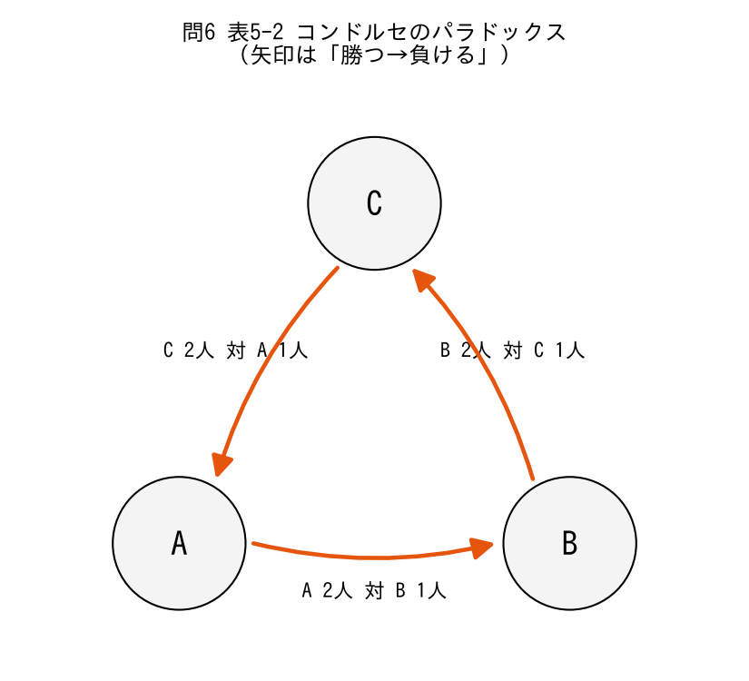

| | 有権者1 | 有権者2 | 有権者3 |
|---|---|---|---|
| 1番目 | A | B | C |
| 2番目 | B | C | A |
| 3番目 | C | A | B |

(1) AとB、AとC、BとCをそれぞれ比べたとき、過半数から好まれるのはどちらか。
(2) コンドルセ勝者は存在するか。コンドルセ法を用いるとどうなるか。
(3) 絶対多数決、相対多数決ではそれぞれどうなるか。
(4) ボルダ方式で各選択肢の点数を求めよ。

**解答・解説**

(1)
- **A対B：Aが勝つ**（有権者1・3がA、有権者2がB）
- **A対C：Cが勝つ**（有権者1がA、有権者2・3がC）
- **B対C：Bが勝つ**（有権者1・2がB、有権者3がC）

(2) **存在しない。コンドルセのパラドックスが生じ、どの選択肢も選べずに終わる**
B＜A、A＜C なのに C＜B となり、社会全体では推移性を満たさない（A→C→B→A と循環する）。各有権者の選好はどれも推移性を満たしている点に注意。

(3) **絶対多数決：何も選ばれない。相対多数決：A・B・Cが確率1/3ずつで選ばれる**
どの選択肢も1番目に好むのは1人だけで、過半数（2人）に届かない。相対多数決では3つが1位に並ぶので、ランダムに選ぶ。コンドルセ勝者がいないので、1/3ずつでも悪くはなさそう。

(4) **A3点、B3点、C3点**
- A：2 ＋ 0 ＋ 1 ＝ 3
- B：1 ＋ 2 ＋ 0 ＝ 3
- C：0 ＋ 1 ＋ 2 ＝ 3

ボルダ方式でも3つが並ぶ。

### ★問7（表5-3 相対多数決とコンドルセ敗者）

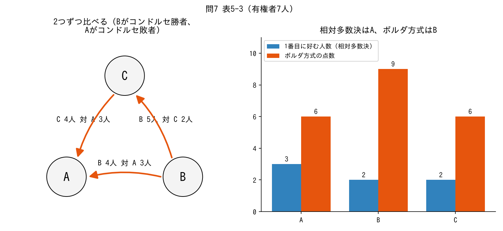

| | 有権者1〜3 | 有権者4・5 | 有権者6・7 |
|---|---|---|---|
| 1番目 | A | B | C |
| 2番目 | B | C | B |
| 3番目 | C | A | A |

(1) 相対多数決と絶対多数決では、それぞれどの選択肢が選ばれるか。
(2) すべての2つの組を比べて、コンドルセ勝者とコンドルセ敗者を求めよ。
(3) ボルダ方式で各選択肢の点数を求め、選ばれる選択肢を答えよ。

**解答・解説**

(1) **相対多数決：A、絶対多数決：何も選ばれない**
1番目に好む人数はA3人・B2人・C2人。Aがいちばん多いが、7人の過半数（4人）には届かない。

(2) **コンドルセ勝者はB、コンドルセ敗者はA**
- A対B：A 3人、B 4人（有権者4〜7）→ **B**
- B対C：B 5人（有権者1〜5）、C 2人 → **B**
- A対C：A 3人、C 4人（有権者4〜7）→ **C**

BはA・Cのどちらにも勝ち、Aはどちらにも負ける。Aは有権者の過半数（4・5・6・7）にとって最下位。相対多数決ではコンドルセ勝者が選ばれないどころか、コンドルセ敗者が選ばれる。

(3) **A6点、B9点、C6点で、Bが選ばれる**
- A：2×3 ＋ 0×2 ＋ 0×2 ＝ 6
- B：1×3 ＋ 2×2 ＋ 1×2 ＝ 9
- C：0×3 ＋ 1×2 ＋ 2×2 ＝ 6

検算：6 ＋ 9 ＋ 6 ＝ 21 ＝ 3点 × 7人。ボルダ方式はコンドルセ敗者の当選を阻止し、コンドルセ勝者を選べた。

### ★問8（表5-4 ボルダ方式とコンドルセ勝者）

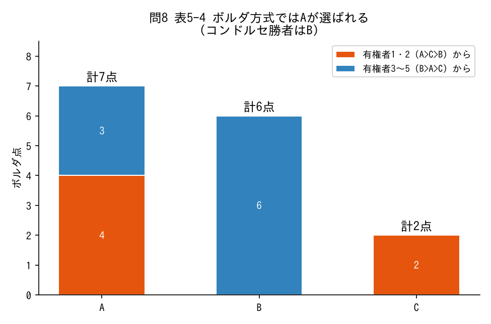

| | 有権者1・2 | 有権者3〜5 |
|---|---|---|
| 1番目 | A | B |
| 2番目 | C | A |
| 3番目 | B | C |

(1) コンドルセ勝者を求めよ。相対多数決・絶対多数決ではどれが選ばれるか。
(2) ボルダ方式で各選択肢の点数を求め、選ばれる選択肢を答えよ。
(3) (1)と(2)の結果が異なる理由を説明せよ。

**解答・解説**

(1) **コンドルセ勝者はB。相対多数決でも絶対多数決でもBが選ばれる**
- A対B：A 2人、B 3人 → B
- B対C：B 3人、C 2人 → B
- A対C：A 5人、C 0人 → A

Bは5人中3人から1番目に好まれ、過半数に達している。

(2) **A7点、B6点、C2点で、Aが選ばれる**
- A：2×2 ＋ 1×3 ＝ 7
- B：0×2 ＋ 2×3 ＝ 6
- C：1×2 ＋ 0×3 ＝ 2

(3) Bは有権者1・2にとって最下位なので、その2人から点数をもらえない。Aは1番目に好むのは2人だけだが、残りの3人からも2番目に好まれて1点ずつもらえる。この3点が効いて合計でBを上回る。**多数決では1番目に好まれることが重要だが、ボルダ方式では1番目でなくてもそれなりに好んでもらうことが重要。**

### 問9
9人の有権者が3つの選択肢に次の選好を持つ。

| | 4人 | 3人 | 2人 |
|---|---|---|---|
| 1番目 | A | B | C |
| 2番目 | B | C | B |
| 3番目 | C | A | A |

(1) 相対多数決、絶対多数決で選ばれる選択肢を答えよ。
(2) コンドルセ勝者とコンドルセ敗者を求めよ。
(3) ボルダ方式で各選択肢の点数を求めよ。
(4) メジャーリーグの最優秀選手投票と同じように、1番目14点・2番目9点・3番目8点とした場合の点数を求めよ。

**解答・解説**

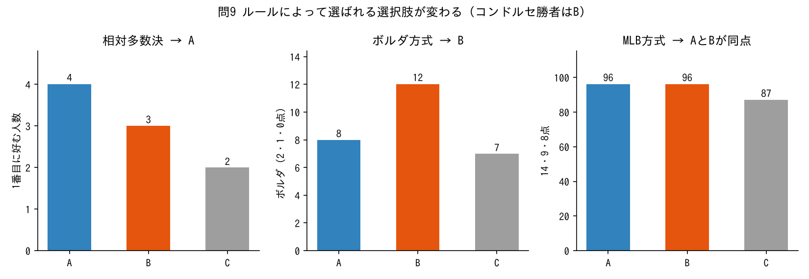

(1) **相対多数決：A、絶対多数決：何も選ばれない**
1番目はA4人・B3人・C2人。Aは9人の過半数（5人）に届かない。

(2) **コンドルセ勝者はB、コンドルセ敗者はA**
- A対B：A 4人、B 5人 → B
- A対C：A 4人、C 5人 → C
- B対C：B 7人、C 2人 → B

(3) **A8点、B12点、C7点（Bが選ばれる）**
- A：2×4 ＝ 8
- B：1×4 ＋ 2×3 ＋ 1×2 ＝ 12
- C：1×3 ＋ 2×2 ＝ 7

検算：8 ＋ 12 ＋ 7 ＝ 27 ＝ 3 × 9。

(4) **A96点、B96点、C87点（AとBが同点）**
- A：14×4 ＋ 8×5 ＝ 56 ＋ 40 ＝ 96
- B：9×4 ＋ 14×3 ＋ 9×2 ＝ 36 ＋ 42 ＋ 18 ＝ 96
- C：8×4 ＋ 9×3 ＋ 14×2 ＝ 32 ＋ 27 ＋ 28 ＝ 87

1番目と2番目の差を大きくすると、1番目に好まれる人数が多いAが有利になり、多数決に近づく。点数の付け方によって結果が変わりうる。

### 問10
7人の有権者が次の選好を持つ。

| | 4人 | 3人 |
|---|---|---|
| 1番目 | B | A |
| 2番目 | A | C |
| 3番目 | C | B |

(1) コンドルセ勝者を求めよ。
(2) ボルダ方式（2点・1点・0点）で選ばれる選択肢を答えよ。
(3) 2番目を1点、3番目を0点のままにして、1番目の点数を s 点（整数）にする。Bが単独で選ばれるのは s がいくつ以上のときか。

**解答・解説**

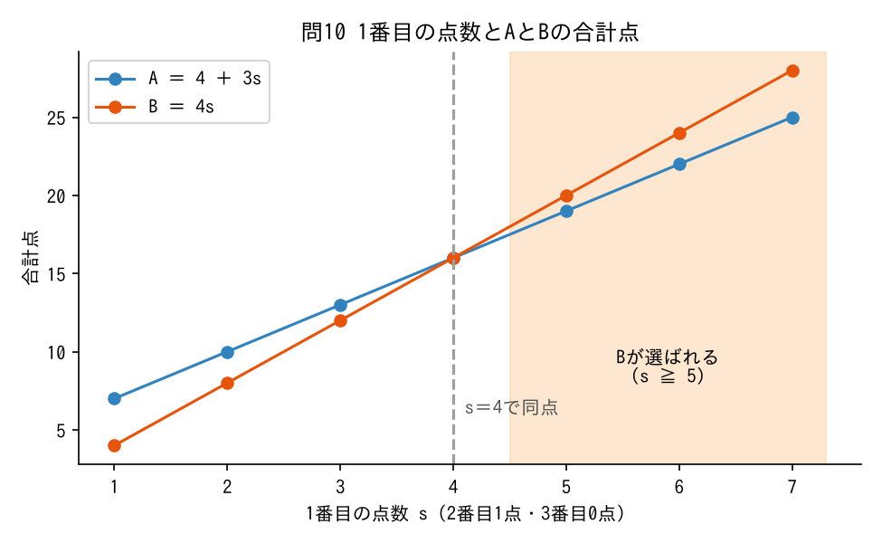

(1) **B**
B対A：B 4人、A 3人。B対C：B 4人、C 3人。Bは7人中4人から1番目に好まれていて過半数。

(2) **A（A10点、B8点、C3点）**
- A：1×4 ＋ 2×3 ＝ 10
- B：2×4 ＝ 8
- C：1×3 ＝ 3

Bは3人から最下位で0点、Aは全員から1番目か2番目なので点数を集める（表5-4と同じ構造）。

(3) **s ≧ 5**
A ＝ 1×4 ＋ s×3 ＝ 4 ＋ 3s、B ＝ s×4 ＝ 4s。4s ＞ 4 ＋ 3s を解くと s ＞ 4。s ＝ 4 では16点で同点。1番目と2番目の点差を十分大きくすると、コンドルセ勝者が選ばれるようになる。

### 問11
5人の有権者が次の選好を持つ。

| | 2人 | 2人 | 1人 |
|---|---|---|---|
| 1番目 | A | B | C |
| 2番目 | B | C | A |
| 3番目 | C | A | B |

(1) すべての2つの組を比べ、コンドルセ勝者が存在するか答えよ。
(2) 相対多数決とボルダ方式では、それぞれどの選択肢が選ばれるか。

**解答・解説**

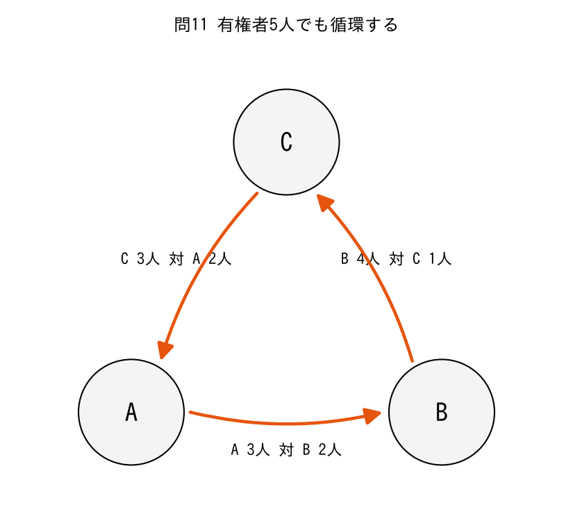

(1) **存在しない（コンドルセのパラドックス）**
- A対B：A 3人（2人＋1人）、B 2人 → A
- B対C：B 4人、C 1人 → B
- A対C：A 2人、C 3人 → C

AはBに勝つがCに負け、BはCに勝つがAに負け、CはAに勝つがBに負ける。有権者が3人より多くても、パラドックスは起こりうる。

(2) **相対多数決：AとBが1位に並び、どちらかがランダムに選ばれる。ボルダ方式：B**
- 1番目：A 2人、B 2人、C 1人
- ボルダ：A ＝ 2×2 ＋ 0×2 ＋ 1×1 ＝ 5、B ＝ 1×2 ＋ 2×2 ＋ 0×1 ＝ 6、C ＝ 0×2 ＋ 1×2 ＋ 2×1 ＝ 4

### 問12（比べる順番の影響）
表5-2の選好で、議長が「2つを比べて勝ち残ったものと残りの1つを比べ、最後に勝ち残ったものを選ぶ」という手続きを**1回だけ**行うとする（すでに比べた組は比べ直さない）。
(1) 最初にAとBを比べた場合、最後に勝ち残るのはどれか。
(2) 最初にBとCを比べた場合、最初にAとCを比べた場合はどうか。
(3) この結果から、どんな問題があるといえるか。

**解答・解説**
(1) **C**
A対B → A が勝ち残り、A対C → C。

(2) **BとCから始めるとA、AとCから始めるとB**
- B対C → B、B対A → A
- A対C → C、C対B → B

(3) **比べる順番によって、A・B・Cのどれでも選ばれうる**
最初の比較で負けた選択肢は二度と登場しないので、勝たせたい選択肢を最後に登場させれば、比べる順番を決める人が結果を操作できる。コンドルセのパラドックスが生じるときは、コンドルセ法の「最後に勝ち残った選択肢」は、比べ直すと別の選択肢に負けてしまう。

---

## アローの不可能性定理

### ★問13（表5-4・表5-5 独立性）

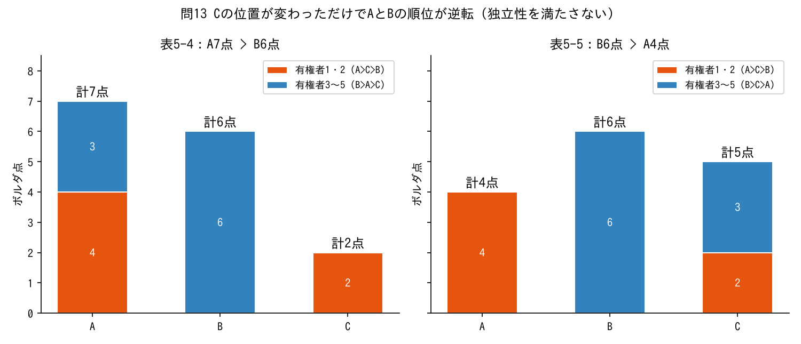

表5-4の選好のうち、有権者3・4・5の選好でCをAより上に移したところ、表5-5のようになった。

| | 有権者1・2 | 有権者3〜5 |
|---|---|---|
| 1番目 | A | B |
| 2番目 | C | C |
| 3番目 | B | A |

(1) 表5-4から表5-5への変化で、AとBのどちらが上かという関係が変わった有権者はいるか。
(2) 表5-5のもとで、ボルダ方式による各選択肢の点数を求めよ。
(3) ボルダ方式が独立性を満たさないことを説明せよ。

**解答・解説**

(1) **いない**
有権者1・2はどちらでも「A＞B」、有権者3〜5はどちらでも「B＞A」のまま。

(2) **A4点、B6点、C5点**
- A：2×2 ＋ 0×3 ＝ 4
- B：0×2 ＋ 2×3 ＝ 6
- C：1×5 ＝ 5

(3) 表5-4ではA7点・B6点で社会としてA＞B、表5-5ではA4点・B6点でB＞A。AとBに対する選好はどの有権者でも変わっていないのに、Cの位置が変わっただけで、社会としてのAとBの順位が逆転した。**2つの選択肢の順位が他の選択肢に影響される**ので、ボルダ方式は独立性を満たさない。

### ★問14（不可能性定理の4つの性質）

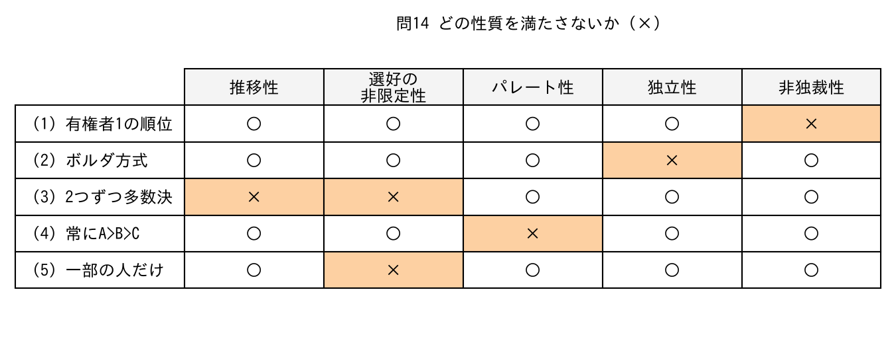

次の社会的選択ルールは、選好の非限定性・パレート性・独立性・非独裁性のうち、どの性質を満たさないか（推移性を満たさない場合はそれも答えよ）。
(1) 有権者1の順位を、そのまま社会の順位とする。
(2) ボルダ方式。
(3) すべての2つの組について多数決で比べ、勝ったほうを社会として上位にする（コンドルセ法の考え方）。
(4) 有権者の選好に関係なく、社会の順位を常に「A＞B＞C」とする。
(5) 社会として順位をつけやすい選好を持った人だけを有権者として認め、他の人の選好は考えない。

**解答・解説**
(1) **非独裁性**
有権者1が独裁者。他の有権者の選好は社会の順位にまったく影響しない。パレート性（全員がAよりBなら有権者1もそう）や独立性は満たす。

(2) **独立性**（問13）
推移性は満たす（点数の大小で順位がつく）。全員がAよりBを好めばBの点数がAより高くなるので、パレート性も満たす。

(3) **推移性（選好の非限定性）**
パレート性・独立性・非独裁性は満たすが、表5-2のような選好ではコンドルセのパラドックスが起き、社会の順位が推移性を満たさない。どんな選好でも推移的な順位をつけられる、という意味では選好の非限定性と両立しない。

(4) **パレート性**
全員がAよりBを好んでも、社会としてAを上にしてしまう。

(5) **選好の非限定性**
特定の選好を持った人たちの集まりだけを想定している。

### 問15
次の文の正誤を答えよ。
(1) 政府の失敗とは、市場に原因があって社会的余剰を最大にする政策が選ばれないことである。
(2) 1人1票の多数決では、各有権者が候補者をどの程度好むかが票に反映される。
(3) 選択肢が2つなら、多数決でもコンドルセ法でも、コンドルセ勝者が選ばれる。
(4) 各有権者の選好が推移性を満たしていれば、投票の結果も必ず推移性を満たす。
(5) 相対多数決では、コンドルセ敗者が選ばれることがある。
(6) ボルダ方式では、コンドルセ勝者が必ず選ばれる。
(7) 不可能性定理は、選択肢が2つの場合にも成り立つ。
(8) 不可能性定理の4つの性質のうち、いちばん多く許容されているのは、選好の非限定性を満たさないことである。
(9) 票の売買で候補者から有権者にお金が渡ると、社会的余剰はその分だけ大きくなる。

**解答・解説**
(1) **×**。市場ではなく**政治過程**に原因がある場合。
(2) **×**。どちらを好むかは反映されるが、どの程度好むかは反映されない。
(3) **○**。
(4) **×**。コンドルセのパラドックス（表5-2）のように、結果が推移性を満たさないことがある。
(5) **○**。表5-3のA。
(6) **×**。表5-4のように、コンドルセ勝者Bではなく、Aが選ばれることがある。
(7) **×**。選択肢が3つ以上の場合の定理。
(8) **○**。選好を限定して議論する。代表例が一次元の政策空間で単峰性を満たす選好。
(9) **×**。お金は候補者から有権者へ移動するだけなので、社会的余剰の大きさには影響しない。

---

## 中位投票者定理

### ★問16（表5-6・図5-1）

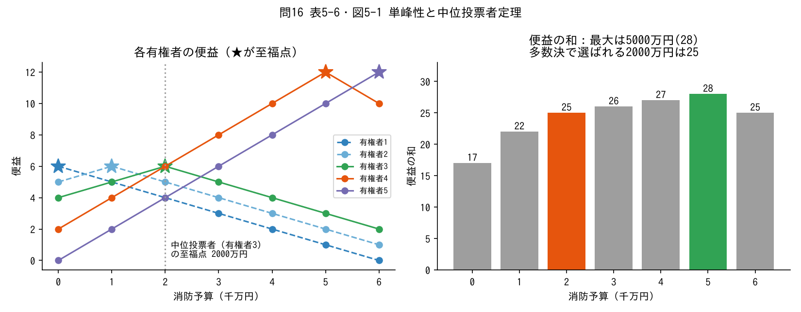

町内の消防予算をいくらにするかを、5人の有権者が決める。選択肢は0円〜6000万円の7つで、各有権者の便益は次のとおりである。

| | 0円 | 1000万 | 2000万 | 3000万 | 4000万 | 5000万 | 6000万 |
|---|---|---|---|---|---|---|---|
| 有権者1 | 6 | 5 | 4 | 3 | 2 | 1 | 0 |
| 有権者2 | 5 | 6 | 5 | 4 | 3 | 2 | 1 |
| 有権者3 | 4 | 5 | 6 | 5 | 4 | 3 | 2 |
| 有権者4 | 2 | 4 | 6 | 8 | 10 | 12 | 10 |
| 有権者5 | 0 | 2 | 4 | 6 | 8 | 10 | 12 |

(1) 各有権者の至福点を求めよ。各有権者の選好は単峰性を満たすか。
(2) 中位投票者は誰か。
(3) 2000万円を、1000万円、3000万円とそれぞれ比べたとき、何人対何人で2000万円が好まれるか。
(4) 便益の和が最大になる予算額と、多数決（コンドルセ法）で選ばれる予算額のときの便益の和を求め、損失を求めよ。
(5) (4)の結果になる理由を説明せよ。

**解答・解説**

(1) **有権者1：0円、2：1000万円、3：2000万円、4：5000万円、5：6000万円。全員が単峰性を満たす**
どの有権者も至福点から離れるほど便益が下がる。有権者1は右下がり、有権者5は右上がりの直線だが、上にとがった個所が1つなので単峰性を満たす（0円より左、6000万円より右の選択肢がないだけ）。

(2) **有権者3**
至福点を小さい順に並べると 0、1000万、**2000万**、5000万、6000万。5人の真ん中（3番目）は有権者3。

(3) **どちらも3人対2人**
- 2000万 対 1000万：有権者3・4・5が2000万（右側の全員＋中位投票者）、有権者1・2が1000万
- 2000万 対 3000万：有権者1・2・3が2000万（左側の全員＋中位投票者）、有権者4・5が3000万

0円・4000万・5000万・6000万と比べても同様に過半数から好まれるので、**2000万円がコンドルセ勝者**（中位投票者定理）。

(4) **最大は5000万円（便益の和28）。選ばれる2000万円は25。損失3**
便益の和：0円17、1000万22、2000万25、3000万26、4000万27、**5000万28**、6000万25。

(5) 有権者4・5は至福点から1000万円離れるごとに便益が2ずつ下がり、有権者1・2・3は1ずつしか下がらない。4・5のほうが至福点から離れることを強く嫌っているので、便益の和を最大にするには4・5の至福点に近づけたほうがよい。しかし1人1票では「どの程度嫌うか」は反映されず、中位投票者の至福点が選ばれる。民主的に選ばれた政策は、必ずしも社会的余剰を最大にしない。

### 問17
有権者5人の至福点が 1000万円・2000万円・4000万円・5000万円・6000万円 で、選択肢は0円〜6000万円（1000万円刻み）である。予算額が至福点から1000万円離れるごとに、有権者1・2（至福点1000万・2000万）は便益が3ずつ、有権者3・4・5は1ずつ下がる。至福点での便益は全員20とする。
(1) 多数決（コンドルセ法）で選ばれる予算額を求めよ。
(2) 2000万円、4000万円のときの便益の和をそれぞれ求めよ。便益の和が最大になる予算額と、(1)の損失を求めよ。
(3) 有権者1の至福点が0円に変わったら、(1)の答えは変わるか。
(4) 有権者5がいなくなり4人になったら、コンドルセ勝者は存在するか。

**解答・解説**

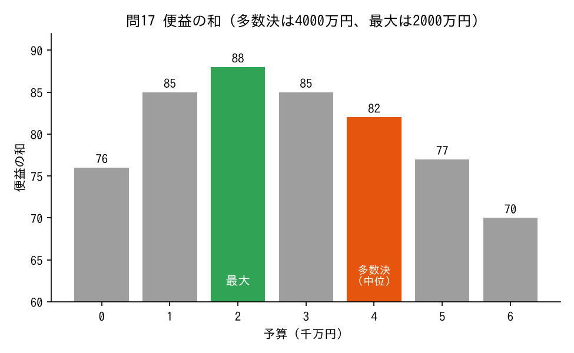

(1) **4000万円**
全員の選好が単峰性を満たし、至福点の真ん中（3番目）は有権者3の4000万円。

(2) **2000万円で88、4000万円で82。最大は2000万円、損失6**
- 2000万円：(20−3) ＋ 20 ＋ (20−2) ＋ (20−3) ＋ (20−4) ＝ 17 ＋ 20 ＋ 18 ＋ 17 ＋ 16 ＝ 88
- 4000万円：(20−9) ＋ (20−6) ＋ 20 ＋ 19 ＋ 18 ＝ 11 ＋ 14 ＋ 20 ＋ 19 ＋ 18 ＝ 82

他の額は 0円76、1000万85、3000万85、5000万77、6000万70 なので、最大は2000万円。表5-6とは逆に、離れることを強く嫌う有権者1・2が少数派なので、選ばれる額は社会的に望ましい額より**大きく**なる。

(3) **変わらない（4000万円のまま）**
中位投票者の至福点は「平均」ではなく「真ん中」。端の有権者の至福点が動いても、真ん中の有権者が変わらなければ結果は同じ。

(4) **存在しない（2000万〜4000万円が引き分けになる）**
至福点は1000万・2000万・4000万・5000万。2000万 対 4000万は、有権者1・2と有権者3・4で2人対2人。教科書の「有権者数が奇数である限り」という条件が必要な理由。

---

## 単峰性が満たされない例

### ★問18（表5-2・図5-2）

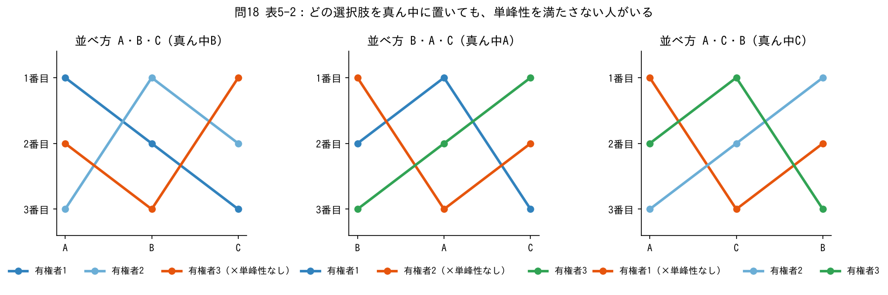

表5-2（有権者1：A＞B＞C、有権者2：B＞C＞A、有権者3：C＞A＞B）について答えよ。
(1) 横軸に左からA・B・Cと並べたとき、単峰性を満たさない有権者は誰か。
(2) 「(1)の結果から、表5-2では単峰性を満たさない有権者がいる」と即座に判断してよいか。
(3) A・B・Cをどう並べても、少なくとも1人の選好が単峰性を満たさないことを示せ。

**解答・解説**

(1) **有権者3**
有権者3はAが2番目、Bが3番目、Cが1番目なので、真ん中のBがくぼみ、両端が高くなる（峰が2つ）。

(2) **判断してはいけない**
A・B・Cは選択肢の名前にすぎず、消防予算のような大小関係がないので、自由に並べ直せる。6通り（ABC、ACB、BAC、BCA、CAB、CBA）のどれでも誰かが単峰性を満たさないことを示す必要がある。

(3) 並べ方の問題は「真ん中に何を置くか」に置き換えられる。真ん中の選択肢がもっとも嫌いな有権者がいると、その人のグラフは真ん中がくぼむ。
- 真ん中がA → 有権者2（Aが3番目）が満たさない
- 真ん中がB → 有権者3（Bが3番目）が満たさない
- 真ん中がC → 有権者1（Cが3番目）が満たさない

どの選択肢も誰か1人からもっとも嫌われているので、どう並べても単峰性を満たさない人がいる。中位投票者定理の前提が成り立たず、実際にコンドルセのパラドックスが生じた。

### 問19
(1) 表5-3（有権者1〜3：A＞B＞C、有権者4・5：B＞C＞A、有権者6・7：C＞B＞A）は、選択肢をうまく並べれば全員が単峰性を満たすか。満たすなら並べ方と中位投票者の至福点を答えよ。
(2) 表5-4（有権者1・2：A＞C＞B、有権者3〜5：B＞A＞C）について、同じことを答えよ。

**解答・解説**

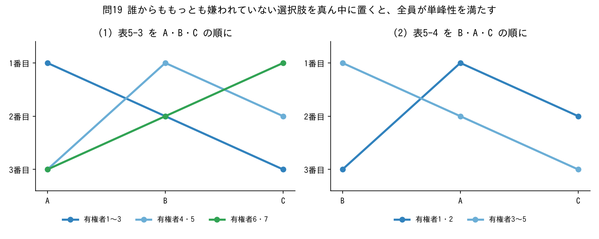

(1) **満たす。並べ方はA・B・C（またはC・B・A）、中位投票者の至福点はB**
もっとも嫌いな選択肢は、有権者1〜3がC、4〜7がA。**Bは誰からももっとも嫌われていない**ので真ん中に置く。至福点を左から並べると A, A, A, **B**, B, C, C で、7人の真ん中（4番目）はB。問7で求めたコンドルセ勝者Bと一致する。

(2) **満たす。並べ方はB・A・C（またはC・A・B）、中位投票者の至福点はB**
もっとも嫌いな選択肢は、有権者1・2がB、3〜5がC。Aは誰からももっとも嫌われていないので真ん中に置く。至福点を左から並べると B, B, **B**, A, A で、5人の真ん中（3番目）はB。問8のコンドルセ勝者Bと一致する（ボルダ方式ではAが選ばれた）。

---

## 熟議民主主義（Column⑤）

### ★問20（表5-7）

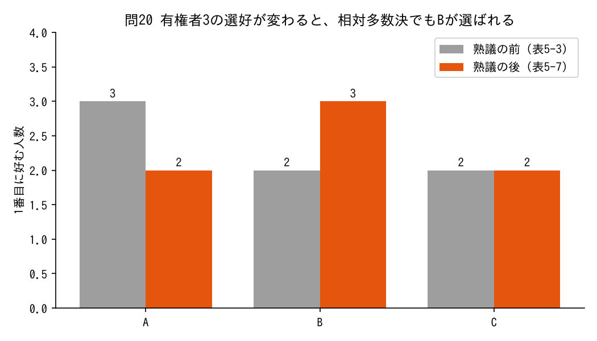

表5-3で、投票前の熟議によって有権者3の選好だけが「A＞B＞C」から「B＞C＞A」に変わった（表5-7）。

| | 有権者1・2 | 有権者3〜5 | 有権者6・7 |
|---|---|---|---|
| 1番目 | A | B | C |
| 2番目 | B | C | B |
| 3番目 | C | A | A |

(1) 相対多数決で選ばれる選択肢を答えよ。
(2) コンドルセ勝者を求めよ。
(3) ボルダ方式で各選択肢の点数を求めよ。
(4) 「熟議」と「交渉」の違いを説明せよ。

**解答・解説**

(1) **B**
1番目に好む人数は A 2人・B 3人・C 2人で、Bが最多の3票。熟議の前（表5-3）はAが選ばれていた。

(2) **B（熟議の前と変わらない）**
- A対B：A 2人、B 5人 → B
- B対C：B 5人（有権者1〜5）、C 2人 → B

(3) **A4点、B10点、C7点**
- A：2×2 ＝ 4
- B：1×2 ＋ 2×3 ＋ 1×2 ＝ 10
- C：1×3 ＋ 2×2 ＝ 7

(4) **熟議**は、議論を通じて人々の選好が変化し、意見がまとまることを期待する。**交渉**は、選好が変わらないまま、交渉力や取引によって話が決着すること。経済学のモデルは選好を変わらないものとして扱うので、選好の変化を念頭に置く熟議民主主義は、経済学と異なる視点を与えてくれる。この例のように、熟議には投票の弱点を補う役割がある。

---

## 戦略的投票とギバード・サタースウェイトの定理

### ★問21（表5-3 相対多数決での戦略的操作）

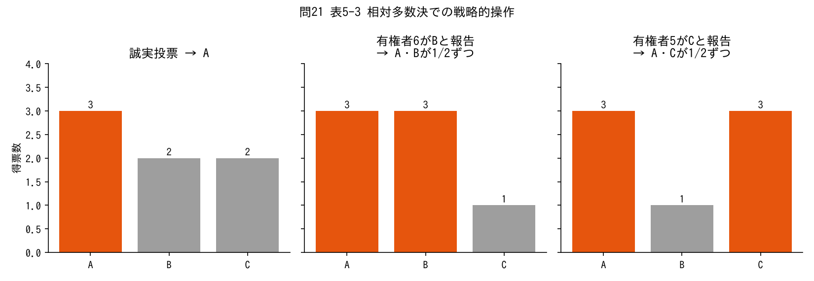

表5-3（有権者1〜3：A＞B＞C、有権者4・5：B＞C＞A、有権者6・7：C＞B＞A）で相対多数決を行う。1位が複数あるときは、その中からランダムに選ばれる。
(1) 全員が誠実投票をすると、どの選択肢が選ばれるか。
(2) 有権者6だけが「Bが1番目」と嘘の報告をすると、結果はどうなるか。有権者6にとって得か。
(3) 有権者5だけが「Cが1番目」と嘘の報告をすると、結果はどうなるか。有権者5にとって得か。
(4) 有権者1〜3には、嘘の報告をするインセンティブがあるか。
(5) こうした戦略的投票が起きると、票はどのように集まるか。

**解答・解説**

(1) **A（確率1）**
A 3票、B 2票、C 2票。

(2) **AとBが3票ずつで、確率1/2ずつ選ばれる。得になる**
有権者6はC＞B＞Aなので、最下位のAが確率1で選ばれるより、2番目のBにも1/2の確率がある方が得。

(3) **AとCが3票ずつで、確率1/2ずつ選ばれる。得になる**
有権者5はB＞C＞Aなので、最下位のAが確率1で選ばれるより、2番目のCにも1/2の確率がある方が得。

(4) **ない**
1番目に好むAがすでに確率1で選ばれているので、報告を変えても得にならない。

(5) **2つの選択肢（この例ではAとB、またはAとC）に票が集まりやすくなる**
自分の1番目が選ばれないなら、それをあきらめて2番目の得票を増やそうとするため。これがデュヴェルジェの法則で、小選挙区制のもとで二大政党制が実現しやすい理由と考えられる。

### 問22
9人の有権者が次の選好を持ち、相対多数決を行う（問9と同じ）。

| | 4人 | 3人 | 2人 |
|---|---|---|---|
| 1番目 | A | B | C |
| 2番目 | B | C | B |
| 3番目 | C | A | A |

(1) 全員が誠実投票をしたときの結果を答えよ。
(2) C＞B＞Aの2人のうち1人だけがBに投票すると、結果はどうなるか。2人ともBに投票するとどうなるか。
(3) C＞B＞Aの2人にとって、Cへの1票はどんな票か。

**解答・解説**
(1) **A（A 4票、B 3票、C 2票）**

(2) **1人だけ：AとBが4票ずつで1/2ずつ。2人とも：Bが5票で確率1で選ばれる**
どちらも、最下位のAが確率1で選ばれるより得。2人がそろってBに移れば、コンドルセ勝者Bが選ばれる。

(3) **死票**
Cは票を集められず、Cに投票しても結果に何も影響を与えられない。自分の1票を活かすなら、票を集められそうなAとBのうち、より好むBに投票する（戦略的投票）。

### ★問23（ギバード・サタースウェイトの定理）
次の文の正誤を答えよ。
(1) ギバード・サタースウェイトの定理は、選択肢が2つの場合の定理である。
(2) ギバード・サタースウェイトの定理では、アローの不可能性定理と同じく、すべての選択肢に社会としての順位をつける。
(3) 「有権者の報告に関係なく、常にAを選ぶ」というルールは、戦略的操作不可能性を満たすが、選択肢の非限定性を満たさない。
(4) 「有権者1が1番目と報告した選択肢を選ぶ」というルールは、戦略的操作不可能性を満たす。
(5) 相対多数決は、戦略的操作不可能性を満たす。
(6) 選好と選択肢の非限定性を満たし、非独裁性も満たすルールでは、少なくとも1人の有権者が戦略的に操作できるような選好の組み合わせが存在する。

**解答・解説**
(1) **×**。選択肢が**3つ以上**の場合。
(2) **×**。社会として**1番目の選択肢だけ**を決める。アローより決めることが少ないのに、それでも4つの性質を同時に満たすルールはない。
(3) **○**。誰がどう報告しても結果が変わらないので嘘をつく意味はないが、B・Cは決して選ばれない。
(4) **○**。独裁者（有権者1）は自分の1番目が選ばれるので嘘をつく必要がなく、他の人は嘘をついても結果を変えられない。ただし非独裁性を満たさない。
(5) **×**。問21のように、有権者6や有権者5が戦略的に操作できる。
(6) **○**。ギバード・サタースウェイトの定理の言い換え。デュヴェルジェの法則の議論の出発点。

---

## 章末問題

### ★問24（章末問題5-1）

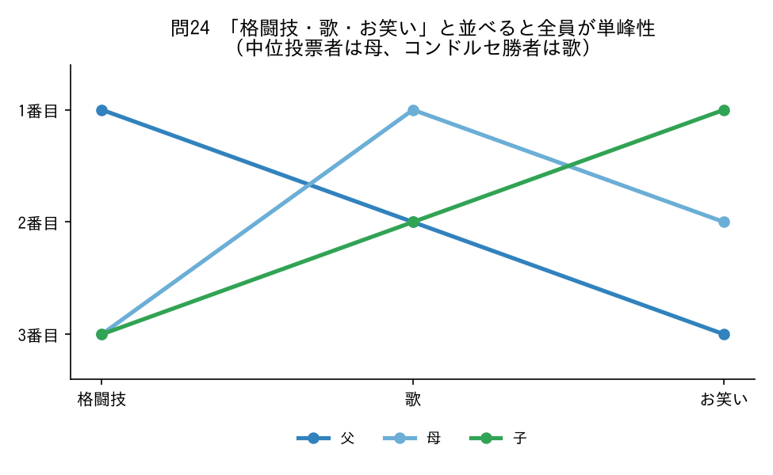

父、母、子の家族が、大晦日の夜に観るテレビ番組を、歌・お笑い・格闘技の3つから選ぶ。観たい順に、父は「格闘技、歌、お笑い」、母は「歌、お笑い、格闘技」、子は「お笑い、歌、格闘技」である。家族のなかで中位投票者は誰か。また、コンドルセ法にしたがって選ぶなら、どの番組を観ることになるか。

**解答・解説**

**中位投票者は母。観る番組は歌**

- **単峰性になる並べ方を探す**：もっとも嫌いな番組は、父がお笑い、母と子が格闘技。**歌は誰からももっとも嫌われていない**ので真ん中に置き、「格闘技・歌・お笑い」と並べる。すると、父は格闘技を峰とする右下がり、母は歌を峰とする山、子はお笑いを峰とする右上がりになり、全員が単峰性を満たす。
- **中位投票者**：至福点を左から並べると 格闘技（父）、**歌（母）**、お笑い（子）。真ん中は母。
- **コンドルセ法**：
  - 歌 対 格闘技：母・子が歌 → 歌（2対1）
  - 歌 対 お笑い：父・母が歌 → 歌（2対1）

歌はどちらにも勝つコンドルセ勝者で、中位投票者（母）の至福点と一致する（中位投票者定理）。

### ★問25（章末問題5-2 決選投票）

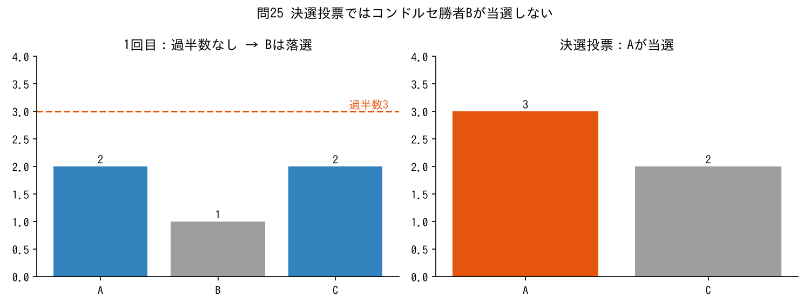

決選投票では、はじめに絶対多数決を行い、過半数の票を獲得した候補者がいればその候補者が当選する。いなければ、上位2人の間でもう一度多数決を行う。有権者5人、候補者A・B・Cの選好が次のとおりのとき、決選投票によってコンドルセ勝者が当選しないことを示せ。

| | 有権者1 | 有権者2 | 有権者3 | 有権者4 | 有権者5 |
|---|---|---|---|---|---|
| 1番目 | A | A | B | C | C |
| 2番目 | B | B | A | B | B |
| 3番目 | C | C | C | A | A |

**解答・解説**

**コンドルセ勝者はBだが、決選投票ではAが当選する**

- **コンドルセ勝者**：
  - B 対 A：有権者3・4・5がB → B（3対2）
  - B 対 C：有権者1・2・3がB → B（3対2）

  BはAにもCにも勝つので、コンドルセ勝者。
- **1回目（絶対多数決）**：A 2票、B 1票、C 2票。過半数（3票）の候補者がいないので、上位2人のAとCで決選投票。
- **決選投票**：A 対 C は、有権者1・2・3がA、有権者4・5がC → **Aが当選**（3対2）。

Bは全員から1番目か2番目に好まれているのに、1番目に好む人が1人しかいないため1回目で落とされる。決選投票は1回目に1番目の情報しか使わないので、相対多数決と同じ弱点を持つ。なお、ボルダ方式なら A5点・B6点・C4点 でBが選ばれる。

---

# 論述問題（中間試験 候補問題）

## 論述1：多数決と社会的余剰

**問題** 1人1票の多数決で選ばれた候補者が、社会的余剰を最大にするとは限らない理由を説明しなさい。また、この問題を解決するために考えられている投票のルールを1つ挙げ、その長所と短所を論じなさい。

**解答例**
1人1票の多数決では、各有権者の票には、その有権者がどちらの候補者を好むかは反映されるが、どの程度好むかは反映されない。そのため、少数の有権者が非常に大きな便益を得る候補者よりも、多数の有権者がわずかな便益を得る候補者が当選することがあり、便益の和が最大にならない。
この問題に対して、貯蓄可能投票というルールが考えられている。各人に複数の票を渡し、どの投票で何票使うかを自由に選ばせるルールである。結果によって便益があまり変わらない投票では票を貯め、大きく変わる投票で一挙に投じることで、好む程度を票に反映でき、便益の和を大きくできる。しかし、意思決定が複数の投票にまたがって複雑になる。また、無関心のために使われなかった票が一挙に投じられると、その結果の正当性が問われる。そのため、実際の選挙に応用するのは難しい。

## 論述2：コンドルセ勝者と投票ルール

**問題** コンドルセ勝者とは何かを説明しなさい。そのうえで、選択肢が3つ以上ある場合に、コンドルセ法、相対多数決、ボルダ方式のそれぞれで生じうる問題を論じなさい。

**解答例**
コンドルセ勝者とは、他のどの選択肢と比べても過半数の人から好まれる選択肢である。選択肢が2つなら、多数決でコンドルセ勝者が選ばれるが、3つ以上になると問題が生じる。
コンドルセ法では、各人の選好が推移性を満たしていても、社会全体の結果が推移性を満たさず、選択肢の間で勝ち負けが循環することがある。これをコンドルセのパラドックスといい、このときはどの選択肢も選べない。相対多数決は、1番目に好む人数の情報しか使わないため、コンドルセ勝者が選ばれないことがあり、過半数から最も嫌われるコンドルセ敗者が選ばれることさえある。ボルダ方式は2番目以下の順位も点数に反映するが、1番目でなくても幅広く好まれる選択肢が有利になるため、コンドルセ勝者が選ばれないことがある。このように、どのルールにも長所と短所がある。

## 論述3：アローの不可能性定理

**問題** アローの不可能性定理の内容を、定理が求める4つの性質に触れて説明しなさい。また、この定理が社会的意思決定にとってどのような意味を持つかを論じなさい。

**解答例**
不可能性定理は、選択肢が3つ以上あるとき、推移性を満たす社会的選択ルールの中に、次の4つの性質を同時に満たすものは存在しないことを示した定理である。1つめは、人々がどんな選好を持っていても機能するという選好の非限定性である。2つめは、全員がある選択肢を別の選択肢より好むなら、社会としてもそう順位づけるというパレート性である。3つめは、2つの選択肢の社会的な順位が、その2つに対する人々の選好だけで決まるという独立性である。4つめは、ある1人の選好が常に社会の順位になる独裁者がいないという非独裁性である。
これらはいずれも民主制で満たされることが望ましい性質だが、すべてを同時に満たすルールは見つけられない。つまり、どんな投票ルールにも欠点があり、人々の選好を集計して社会としての順位を決めることは本質的に難しい。そのため、実際には、選好の非限定性をあきらめて人々の選好を一定の範囲に限定するなど、どれかの性質を緩めて社会的選択ルールを考えることになる。

## 論述4：中位投票者定理と社会的余剰

**問題** 中位投票者定理の内容を、単峰性の意味に触れて説明しなさい。また、民主的に選ばれた政策が社会的余剰を最大にするとは限らない理由を論じなさい。

**解答例**
政策の選択肢を数直線上に並べられるとき、各有権者がもっとも好む選択肢を至福点という。至福点から離れるほど便益が下がることを単峰性という。すべての有権者の選好が単峰性を満たすとき、至福点が全体のちょうど真ん中に位置する有権者を中位投票者という。中位投票者の至福点を他の選択肢と比べると、中位投票者自身と、比べる選択肢の反対側にいる全員がそれを好む。有権者が奇数なら左右に同じ数の有権者がいるので、中位投票者の至福点は他のどの選択肢にも過半数で勝つコンドルセ勝者になる。これを中位投票者定理という。
ただし、1人1票の多数決では、各有権者がどちらを好むかは反映されるが、至福点から離れることをどの程度嫌うかは反映されない。そのため、少数の有権者が強く嫌がっていても、中位投票者の至福点が選ばれる。したがって、民主的に選ばれた政策は必ずしも社会的余剰を最大にしない。

## 論述5：戦略的投票とギバード・サタースウェイトの定理

**問題** 戦略的投票とは何かを説明しなさい。そのうえで、ギバード・サタースウェイトの定理の内容と、相対多数決のもとで生じるデュヴェルジェの法則について論じなさい。

**解答例**
自分が1番目に好む選択肢に常に投票することを誠実投票という。しかし、1番目に好む選択肢が票を集められそうにないなら、その票は結果に影響しない死票になる。そこで、票を集められそうな選択肢の中でもっとも好むものに投票することがある。このように、自分の1票が結果にどう影響するかを考えて投票することを戦略的投票という。
ギバード・サタースウェイトの定理は、選択肢が3つ以上のとき、どんな選好にも対応でき、どの選択肢も選ばれる可能性があり、誰も嘘の報告で得をできないルールには、必ず独裁者がいることを示した。つまり、独裁的でないルールでは、嘘の報告で得をできる有権者が必ず現れうる。
相対多数決はその典型である。自分の1番目が選ばれそうにない有権者は、2番目に好む選択肢に票を移す。その結果、票が2つの選択肢に集まりやすくなる。これをデュヴェルジェの法則といい、小選挙区制の国で二大政党制が生まれやすい理由とされる。
